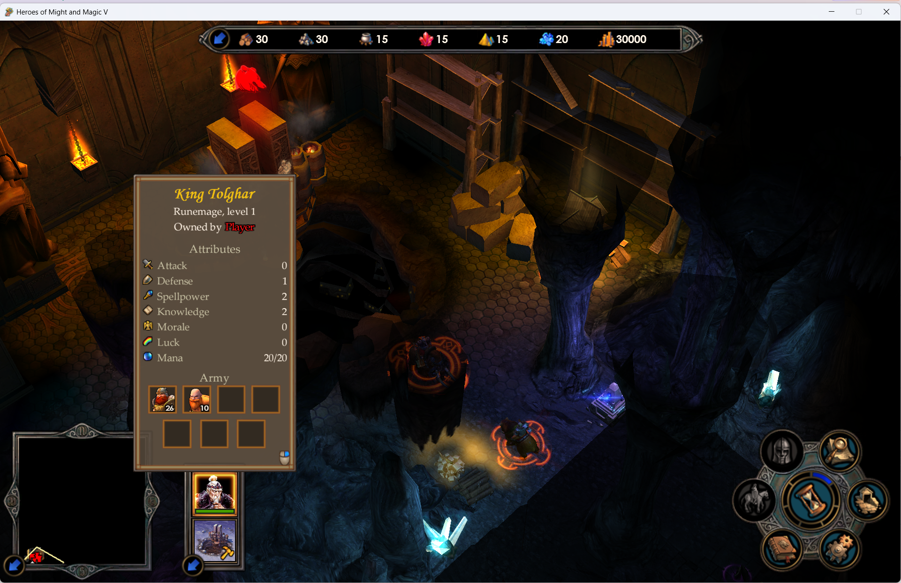

# HoMM5 Widescreen Patch

This mod adds proper windowed mode to Heroes of Might and Magic V & Hammers of Fate and realigns UI without stretching on 16:9 resolutions. Also, for all three games it optionally removes fade-to-black effect on launch + removes intro videos. It also optionally replaces Monotype Corsiva in regular text (non-headers) with Palatino Linotype.

Mod works with [GOG version](https://www.gog.com/en/game/heroes_of_might_and_magic_5_bundle) and [Steam version](https://store.steampowered.com/bundle/5584/Heroes_of_Might_and_Magic_Collection) of the games.



## Features (Heroes V + Hammers of Fate)

- **Widescreen UI**. Keep UI spacing at any aspect ratio (virtual screen backported from ToE). Cutscenes and loading screen also have letterbox side bars on 16:9 as in ToE.
- **Fullscreen option**. Adds Fullscreen checkbox to video settings.
- **HoF windowed mode**. Fixes stock version not having window frame when switched to windowed mode.

> [!NOTE]
> Stock Tribes of the East already has widescreen support and windowed mode. Except it ships with Dark Messiah mod, a standalone exe build which does not have widescreen support. Dark Messiah mod is not supported by this patch.

## Optional features (all three games)

- **Skip splash fade and intro**. Removes the 2 second fade to black effect before the splash screen and removes the intro videos (replaced with blank clip for correctness).
- **Font fix**. Reading that much of Monotype Corsiva is insufferable. This mod renders body texts with Palatino Linotype.

## Installation

1. Close the games and extract the release zip.
2. Copy `dinput8.dll` from the zip next to each `H5_Game.exe`: `bin\` for Heroes V and Tribes of the East, `bina1\` for Hammers of Fate.
3. Run `homm5-widescreen-patch.exe`. If the games are under `Program Files`, run it as administrator. 
	- **Open folders** opens the game folders plus folder with dinput8.dll in Explorer so you just need Ctrl-C and do Ctrl-V in each game folder. 
	- **Install** stays disabled until every detected game has the DLL.
4. Choose the options and click **Install**. Building the game data takes a few seconds per game.

> [!WARNING]
> For some reason, HoMM5 games persist UI layout in save game files. You need to start a mission / custom map anew to see UI fix working.

Click **Uninstall** to remove everything the patch installed. Running Install again with different options rebuilds the files.

## How it works

- DLL hook via `dinput8.dll` next to `H5_Game.exe` patches game memory at startup. DirectInput passed to the system DLL as usual. Original exe files are preserved.
- Extra `.pak` archive per game contains the files needed for layout fixes and the new font files, as well as blank intro vid pointer.

> [!NOTE]
> Some antiviruses may flag the dll because of hot patching.
>
> The exe and the DLL are not signed. Windows SmartScreen will show "Windows protected your PC" for the patcher. With Smart App Control turned on, Windows may block the unsigned `dinput8.dll` and the game won't start.
>
> This mod does not contain any malware & only Win11 setup was ever tested.

No Ubisoft or Linotype assets are shipped, everything game-specific is built from game files on your machine.

Installed files:

| Where | Files |
|---|---|
| `bin\`, `bina1\` (ToE: `bin\`) | `dinput8.dll`, `homm5-widescreen.ini`, `homm5-widescreen.log` (written by the DLL) |
| `datals\`, `dataa1\` (ToE: `data\`) | `homm5-widescreen.pak` |
| `video\` (with "Skip intro") | `homm5-intro.xml`, `homm5-blank.ogg` |

`homm5-widescreen.log` logs what the DLL did at the last game run. If the game folder is read-only for the game (e.g. under `Program Files`), the log goes to `%LOCALAPPDATA%\homm5-widescreen\` instead.

## Languages

For font swap, every GOG language except Simplified Chinese should work: Czech, English, French, German, Hungarian, Italian, Polish, Russian, Spanish. Only EN was tested though.

If installed games are in Chinese, font fix option is unavailable during install.

If you want to switch the language in installed game, uninstall the mod first.

## Building

Visual Studio 2022 (C++ desktop workload), CMake 3.24+, 32-bit target:

```
cmake -S . -B build -G "Visual Studio 17 2022" -A Win32
cmake --build build --config Release
```

Builds `homm5-widescreen-patch.exe` (recipes and the clip embedded) and `dinput8.dll`.

Dev tools:
- `homm5-data-build`: rebuilds the layout pak from a recipe, for byte-for-byte checks.
- `homm5-font-build`: builds the font paks from a game or from given paks.

Third-party code: zlib 1.3.2 with its minizip (zlib licence).

## Implementation details

### The blank intro clip ([src/data/blank.ogg](src/data/blank.ogg))

Trivia found on google suggests removing intro videos by editing intro.xml. That works, but causes no-texture main menu and some textures in game like cloud shadows to break. To overcome that, I generated 0.4s blank clip. It was not straightforward:

- **Exact codecs.** HoMM5 video player is built on libtheora 1.0alpha3 (2004) and libvorbis 1.0.1. Theora decoder only accepts the original VP3 quantisation tables. Anything from a modern libtheora, ffmpeg included, writes the newer tables, so the headers are rejected. The audio thread is already running at that point and crashes. Had to encode with exact same library versions.
- **Dummy file is too small.** The player reads the file in 4 KB chunks. After the headers it only takes further pages out of its buffer after another successful read. A clip that is read completely during header parsing leaves its last audio page in the buffer. Game shows a black screen until you click left mouse button. For that matter, the crafted clip ends with a 4 KB padding page in a third logical stream, which the video player ignores, so at least one more read happens.

## Credits

Built with Opus 5.5.

This mod was made possible by [REA: Reverse Engineer Anything](https://github.com/morluto/rea) skill set.
